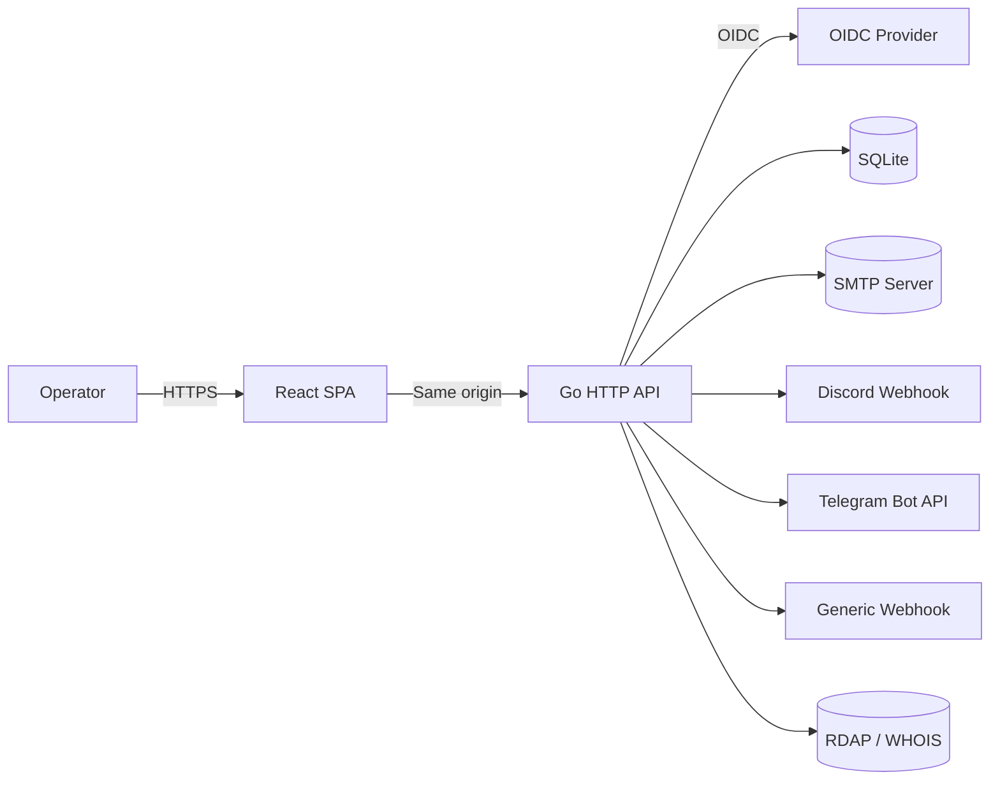
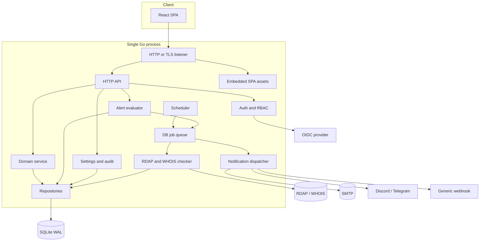
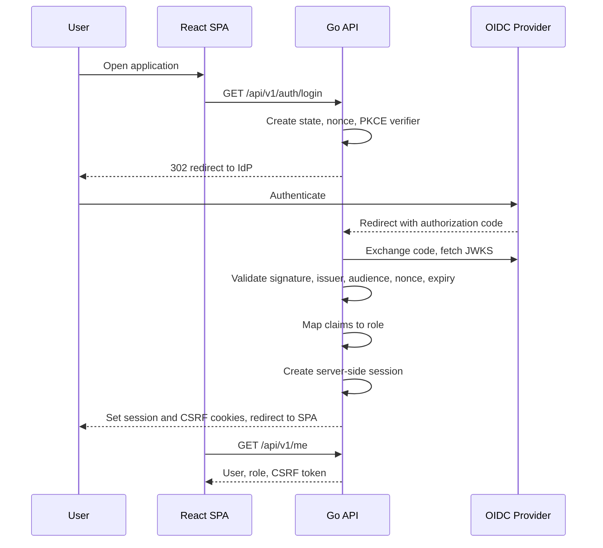
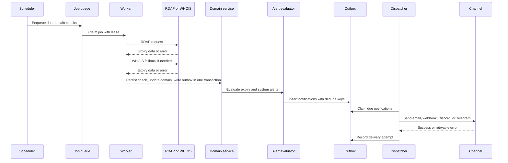
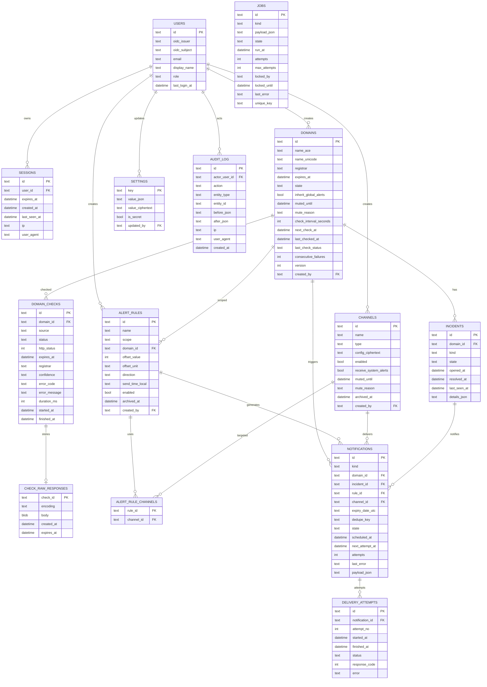
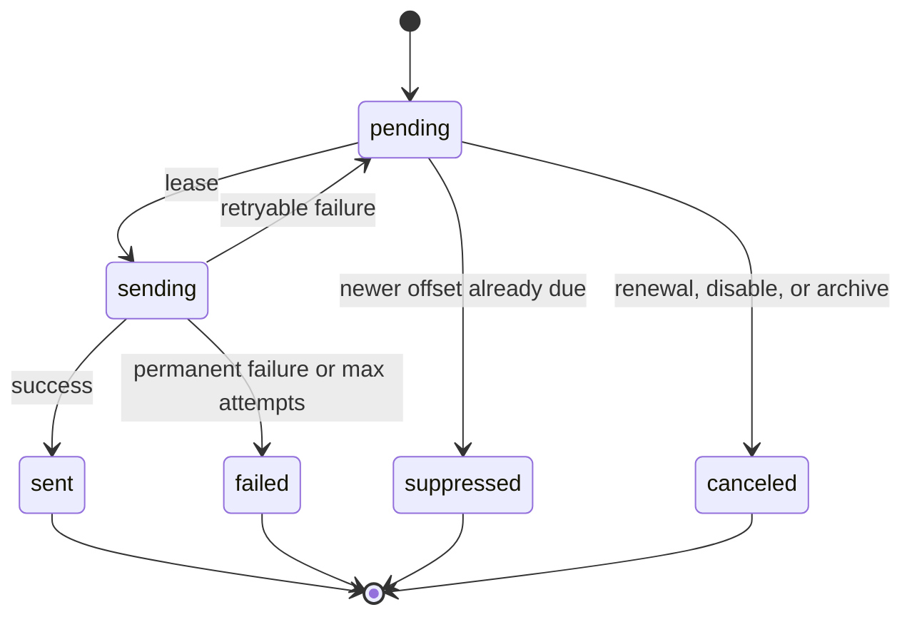

# IWMMD Architecture

**IWMMD** = I Want to Monitor My Domains.

Self-hosted domain expiration monitor for small teams. Checks domain expiration with RDAP and WHOIS, stores history, and sends configurable alerts through email, generic webhooks, Discord, and Telegram.

- Status: v1 design
- Last updated: 2026-10-20
- Deployment: published GHCR image, static Linux binaries, and local build
- Target scale: up to 100 monitored domains, single instance

## Table of contents

1. [Goals and non-goals](#1-goals-and-non-goals)
2. [Stack](#2-stack)
3. [System architecture](#3-system-architecture)
4. [Module layout](#4-module-layout)
5. [Core flows](#5-core-flows)
6. [Data model](#6-data-model)
7. [Domain checking and scheduling](#7-domain-checking-and-scheduling)
8. [Alert engine](#8-alert-engine)
9. [Notification channels](#9-notification-channels)
10. [Authentication and authorization](#10-authentication-and-authorization)
11. [Security](#11-security)
12. [API](#12-api)
13. [Frontend](#13-frontend)
14. [Configuration](#14-configuration)
15. [TLS](#15-tls)
16. [SQLite operations](#16-sqlite-operations)
17. [Deployment](#17-deployment)
18. [Observability](#18-observability)
19. [Testing](#19-testing)
20. [Milestones](#20-milestones)
21. [Risks](#21-risks)
22. [Decision log](#22-decision-log)
23. [Future work](#23-future-work)

---

## 1. Goals and non-goals

### Goals

- Self-hosted deployment for a small team.
- OIDC as the only authentication method.
- Role and group enforcement from identity provider claims.
- Domain expiration checks through RDAP first, WHOIS fallback.
- Manual alert intervals in days or calendar months, before and after expiration.
- Configurable send time per alert rule with a global default.
- Mute alerts for a domain, a channel, or globally.
- Email, generic webhook, Discord, and Telegram notifications.
- Alert history, delivery attempts, and audit log.
- Dark and light UI.
- Docker Compose/run as primary deployment.
- Published multi-arch image and static Linux binaries.
- Copy-paste Compose quick start with the published image.
- Local image build from source for FOSS users.
- Standalone binary with TOML config as secondary deployment.
- SQLite as the only database in v1.
- Optional built-in TLS listener.
- Web configuration for SMTP, channels, alert defaults, and system alerts.

### Non-goals for v1

- Multi-tenant SaaS.
- MySQL or Postgres support.
- Redis, Kafka, NATS, or an external job queue.
- Microservices or distributed workers.
- Kubernetes-first deployment.
- DNS, TLS certificate, or uptime monitoring.
- Automatic ACME certificate issuance.
- Slack adapter.
- Pre-authentication setup wizard.
- WebSocket or server-sent events.
- Per-rule mute.
- Local password authentication.
- Mobile application.
- Public API tokens.

---

## 2. Stack

| Layer | Choice | Reason |
|---|---|---|
| Backend | Go, latest stable | Static binary, low memory, good concurrency |
| HTTP router | `net/http` + chi | Stdlib-first, lightweight middleware |
| API contract | OpenAPI 3.1 + `oapi-codegen` | Typed server and generated TypeScript client |
| Database | SQLite WAL via `modernc.org/sqlite` | CGO-free, zero external services |
| Queries | `sqlc` | Type-safe SQL, no ORM magic |
| Migrations | `goose` with embedded SQL | Simple, deterministic, works offline |
| Jobs | DB-backed queue, in-process workers | Durable retries without Redis |
| Auth | OIDC authorization code + PKCE | No passwords, no browser tokens |
| Sessions | Opaque server-side sessions | Revocable, secure cookies |
| Frontend | React + TypeScript + Vite | Chosen SPA stack |
| Routing | TanStack Router | Typed routes |
| Server state | TanStack Query | Cache, polling, mutations |
| Styling | Tailwind CSS | Dark/light themes, small CSS surface |
| UI primitives | Radix UI | Accessible dialogs, menus, popovers |
| Forms | `react-hook-form` + `zod` | Standard validation flow |
| Email | `wneessen/go-mail` | TLS modes, attachments, sane API |
| HTTP client | stdlib + `x/time/rate` + backoff | Timeouts, throttling, retries |
| Logging | `log/slog` | Structured stdlib logging |
| Metrics | Prometheus client | Simple operational visibility |
| Config | TOML standalone, `IWMMD_` env in Docker | Project-scoped file, prefixed global env |
| Build | pnpm + multi-stage Docker | Reproducible frontend and backend builds |
| Image publishing | GHCR, multi-arch | Copy-paste deployment and FOSS local build |
| Runtime image | Distroless static, non-root | Small attack surface |
| Tests | Go test, Vitest, Playwright | Unit, integration, E2E |

### Rejected alternatives

| Alternative | Why rejected |
|---|---|
| Redis or BullMQ | Extra service for 100 domains |
| Kafka, NATS | Operational overkill |
| Microservices | More deployment and debugging cost |
| JWT in browser storage | XSS exposure |
| GORM or Ent | Explicit SQL is easier to audit |
| Postgres in v1 | SQLite is enough for this scale |
| MySQL in v1 | Triples migration and test matrix |
| Slack in v1 | User selected email, webhook, Discord, Telegram only |
| WebSocket | Polling is enough for this workload |

---

## 3. System architecture

### 3.1 Context



### 3.2 Components in one process



### 3.3 Architecture style

- Modular monolith.
- One deployable binary.
- One database.
- One scheduler.
- One worker pool.
- Clear module boundaries through interfaces.
- No distributed transactions.
- Durable jobs and an outbox table for reliability.
- Same-origin SPA in production.

The advanced part is not distributed infrastructure. It is durable job state, idempotent alert generation, retries, leases, and explicit failure states.

---

## 4. Module layout

```text
/cmd/iwmmd
  main.go

/internal/app
  app.go                 composition root
  workers.go             scheduler and worker wiring

/internal/auth
  oidc.go                discovery, PKCE, token validation
  providers.go           provider presets
  roles.go               claim and email mapping
  sessions.go            session cookie and store
  csrf.go

/internal/domain
  service.go             create, update, archive, restore, permanent delete, import
  normalize.go           IDNA and validation
  expiry.go              expiry date and calendar math

/internal/checker/rdap
  bootstrap.go           IANA bootstrap cache
  client.go              HTTP fetch and rate limiting
  parser.go              expiration and registrar extraction

/internal/checker/whois
  referral.go            IANA referral and server cache
  client.go              port 43 client
  parser.go              generic and registry-specific parsing

/internal/demo
  demo.go                demo seed, reset loop, anonymous identity

/internal/alert
  rules.go               rule validation
  evaluator.go           due offset calculation
  dedupe.go              notification keys
  incidents.go           system incidents

/internal/notify
  dispatcher.go          delivery worker
  retry.go               backoff policy
  email.go
  webhook.go
  discord.go
  telegram.go

/internal/jobs
  queue.go               enqueue, claim, lease, retry
  scheduler.go           due domain scan

/internal/store
  sqlite/
    db.go
    domains.go
    checks.go
    alerts.go
    channels.go
    settings.go
    jobs.go
    audit.go
    incidents.go
    sessions.go

/internal/httpapi
  router.go
  middleware.go
  auth_handlers.go
  domain_handlers.go
  alert_handlers.go
  channel_handlers.go
  settings_handlers.go
  audit_handlers.go
  health.go
  metrics.go

/internal/settings
  config.go              env and TOML bootstrap
  runtime.go             DB-backed settings
  secrets.go             AES-GCM encryption

/internal/audit
  service.go

/internal/platform
  clock.go
  ids.go
  logging.go
  metrics.go
  version.go

/internal/webui
  embed.go               go:embed dist
  dist/                  built SPA assets

/migrations/sqlite
  0001_init.sql
  ...

/web
  package.json
  vite.config.ts
  src/

/Dockerfile              published image and local build
/compose.yaml            quick start with published image
/compose.build.yaml      local build overlay
/.env.example            quick start environment template
/config.example.toml     standalone config template
/.dockerignore

/.github/workflows
  release.yml            image, static binary, and GitHub release build
/.github/release-notes
  vX.Y.Z.md              release notes used by the release workflow

/deploy
  iwmmd.service          standalone systemd unit
```

### Dependency rules

- HTTP handlers call services.
- Services call repositories and adapters.
- Checker and notifier are adapters behind interfaces.
- Repositories do not import HTTP or notification packages.
- `internal/app` is the only composition root.
- No cyclic imports.
- Domain logic does not depend on SQLite driver types.

---

## 5. Core flows

### 5.1 OIDC login



### 5.2 Domain check and alert generation



### 5.3 Request flow

1. Browser sends same-origin request with session cookie.
2. Middleware validates session and loads user.
3. CSRF middleware validates mutation requests.
4. RBAC middleware checks role for route.
5. Handler validates input and calls service.
6. Service uses repository inside transaction.
7. External calls happen outside transactions.
8. Audit event written for mutations.
9. JSON response returned.

---

## 6. Data model

### 6.1 Entity relationship diagram



### 6.2 Table notes

| Table | Purpose |
|---|---|
| `users` | OIDC-provisioned users and current role |
| `sessions` | Server-side sessions, hashed tokens |
| `domains` | Monitored domains and scheduling state |
| `domain_checks` | Check history without raw payloads |
| `check_raw_responses` | Compressed raw RDAP/WHOIS responses, short retention |
| `alert_rules` | Global or domain-scoped expiry rules |
| `alert_rule_channels` | Rule-to-channel mapping |
| `channels` | Email, webhook, Discord, Telegram configuration |
| `notifications` | Outbox and delivery state |
| `delivery_attempts` | Per-attempt delivery history |
| `incidents` | System alert state for check and parse failures |
| `jobs` | Durable queue for checks and maintenance |
| `settings` | Runtime settings and encrypted secrets |
| `audit_log` | Security and configuration audit trail |

### 6.3 Important constraints

- `domains.name_ace` unique.
- `users(oidc_issuer, oidc_subject)` unique.
- `alert_rule_channels(rule_id, channel_id)` primary key.
- `notifications.dedupe_key` unique.
- Active jobs have a partial unique index on `unique_key` where `state IN ('pending', 'running')`.
- Open incidents have a partial unique index on `(domain_id, kind)` where `state = 'open'`.
- `alert_rules` check: `offset_value > 0 OR direction = 'before'`. Zero after expiry is not allowed. Zero before means expiry day.
- `domains.version` increments on update for optimistic concurrency.
- `channels` and `alert_rules` use soft archive through `archived_at`.
- `domains` use soft archive through `state = 'archived'` and `archived_at`. Restore clears both.
- Permanent domain deletion is admin-only, requires the archived state, and cascades checks, rules, incidents, and notifications. It also removes the `domain-check:<id>` job.
- Delete endpoints archive channels and rules so delivery history stays intact.
- All timestamps stored UTC.
- IDs are UUIDv7 for time-sortable primary keys.

### 6.4 Indexes

```sql
CREATE INDEX idx_domains_next_check
  ON domains(state, next_check_at);

CREATE INDEX idx_domains_expires
  ON domains(expires_at);

CREATE INDEX idx_checks_domain_time
  ON domain_checks(domain_id, started_at DESC);

CREATE INDEX idx_jobs_ready
  ON jobs(state, run_at);

CREATE INDEX idx_notifications_ready
  ON notifications(state, next_attempt_at);

CREATE INDEX idx_notifications_domain_channel
  ON notifications(domain_id, channel_id, scheduled_at DESC);

CREATE INDEX idx_incidents_open
  ON incidents(domain_id, kind, state);

CREATE UNIQUE INDEX idx_incidents_one_open
  ON incidents(domain_id, kind)
  WHERE state = 'open';

CREATE INDEX idx_audit_time
  ON audit_log(created_at DESC);
```

### 6.5 Retention

| Data | Default retention |
|---|---|
| Raw RDAP/WHOIS responses | 30 days |
| Check summaries | 365 days |
| Notifications and attempts | 365 days |
| Incidents | 365 days |
| Audit log | 365 days |
| Completed jobs | 7 days |
| Expired sessions | Delete daily |
| Archived domains | Until permanently deleted by an admin |

Retention values are runtime settings. Cleanup is a scheduled job.

---

## 7. Domain checking and scheduling

### 7.1 Domain normalization

- Trim whitespace.
- Lowercase.
- Strip trailing dot.
- Reject URLs, paths, wildcards, IP literals, and schemes.
- Convert IDN to ASCII with `golang.org/x/net/idna`.
- Store ACE form in `name_ace`, Unicode form in `name_unicode`.
- Validate label lengths and allowed characters.
- Deduplicate on `name_ace`.

### 7.2 RDAP first

- Load IANA RDAP bootstrap from `https://data.iana.org/rdap/dns.json`.
- Cache bootstrap for 24 hours.
- Persist cached bootstrap to disk.
- Use stale cache if refresh fails.
- Select RDAP base URL by TLD.
- Fetch domain object with 15-second timeout.
- Extract expiration event, registrar, status, and nameservers.
- Record HTTP status and parse confidence.
- Handle `429` with `Retry-After`.
- Retry `5xx` with backoff.
- Do not retry `404` indefinitely.

### 7.3 WHOIS fallback

- Query IANA WHOIS for registry referral.
- Cache WHOIS server per TLD.
- Query registry WHOIS on port 43.
- Use 10-second timeout.
- Parse with generic patterns first.
- Use registry-specific parsers where needed.
- Store raw response for debugging.
- Set confidence to low when only a generic parse succeeds.
- Mark unsupported when no expiry field exists.

### 7.4 Expiry confidence

| Confidence | Meaning |
|---|---|
| `high` | RDAP expiration event parsed |
| `medium` | Registry-specific WHOIS field parsed |
| `low` | Generic WHOIS pattern parsed |
| `unknown` | No expiry field found |

Unknown expiry:

- Domain remains monitored.
- Dashboard shows warning.
- No expiry alerts are generated.
- System incident is opened once.
- Incident resolves when expiry becomes known.

### 7.5 Scheduling

- Scheduler tick every 30 seconds.
- Enqueue checks for domains where `next_check_at <= now`.
- Default interval: 24 hours.
- When 30 days or less remain: 12 hours.
- When 7 days or less remain: 6 hours.
- After expiration: 12 hours.
- Per-domain interval override.
- Add plus or minus 10 percent jitter.
- Manual check allowed once per 5 minutes per domain.
- Paused domains are not checked.
- Archived domains are not checked.
- Restoring an archived domain activates it, schedules an immediate check, and reconciles expiry alerts.

### 7.6 Rate limits

- Global worker concurrency: 4.
- Per-RDAP-base-URL token bucket.
- Per-WHOIS-server token bucket.
- Respect `Retry-After`.
- Exponential backoff on repeated failures.
- Never bypass registry limits for manual checks.
- Manual check may queue behind rate limit.

### 7.7 Failure handling

- Increment `consecutive_failures` on failed check.
- Reset on success.
- After 3 consecutive failures, open `check_failure` incident.
- Send one system alert when incident opens.
- Send recovery notice when incident resolves.
- Do not disable domain automatically.
- Keep last known expiry until a successful check replaces it.

### 7.8 Durable jobs

Job states:

- `pending`
- `running`
- `succeeded`
- `failed`
- `dead`

Claim flow on SQLite:

1. Open immediate write transaction.
2. Select oldest ready job.
3. Update state to `running`, set lease owner and lease expiry.
4. Commit.
5. Execute job outside transaction.
6. Mark complete or schedule retry.

Lease recovery:

- Worker heartbeat extends lease.
- Expired leases return to `pending`.
- Attempt counter increments.
- Max attempts default: 5 for checks, 8 for notifications.
- Dead jobs remain visible for diagnostics.

Idempotency:

- Active unique key prevents duplicate pending checks per domain.
- Notification dedupe key prevents duplicate alerts.
- Job retries must be safe.
- Persistence happens in transactions after external fetch.

---

## 8. Alert engine

### 8.1 Rule model

Alert rule fields:

```text
scope            global | domain
domain_id        nullable, required for domain scope
offset_value     positive integer
offset_unit      days | months
direction        before | after
send_time_local  HH:MM, nullable
enabled          boolean
```

Examples:

| Rule | Meaning |
|---|---|
| 2 months before | Calendar date two months before expiry |
| 30 days before | 30 calendar days before expiry |
| 7 days before | 7 calendar days before expiry |
| 0 days before | Expiry day |
| 1 day after | Calendar day after expiry |
| 7 days after | 7 calendar days after expiry |
| 1 month after | Calendar month after expiry |

Validation:

- `offset_value >= 0`.
- Zero offset allowed only with `direction = before`.
- `offset_unit` is `days` or `months`.
- `send_time_local` is a valid 24-hour time.
- Empty send time uses global default.

### 8.2 Rule scope

- Global rules apply to all active domains.
- Domain rules add extra alerts for one domain.
- Global and domain rules are additive.
- Duplicate offset and channel are deduplicated.
- `domains.inherit_global_alerts` can disable global rules for a domain.
- Domain rules still apply when global inheritance is disabled.
- Global rules require admin. Domain rules require member or admin.
- Disabled rules generate no new notifications.
- Pending notifications for a disabled rule are canceled.
- Pending notifications for an archived rule are canceled.

### 8.3 Calendar math

Expiration date is evaluated in the configured timezone.

For days:

```text
due_date = expiry_local_date + offset_days
```

For months:

```text
due_date = add_calendar_months(expiry_local_date, offset_months)
```

Month rules:

- Months are calendar months, not 30-day blocks.
- Clamp to last valid day of target month.
- Example: 31 March minus 1 month = 28 or 29 February.
- Example: 31 May plus 1 month = 30 June.
- Use IANA timezone data.
- Do not use fixed UTC offsets.

Send timestamp:

```text
send_time = rule.send_time_local or settings.default_alert_time
due_at = time.Date(due_date, send_time, settings.timezone)
```

DST behavior:

- Nonexistent local time in spring-forward gap: move to next valid minute.
- Ambiguous local time in fall-back overlap: use first occurrence.
- Both cases require tests.

### 8.4 Dedupe

Dedupe key is a hash of:

```text
domain_id
channel_id
expiry_date_utc
offset_value
offset_unit
direction
kind
```

Properties:

- Use expiration date in UTC, not exact timestamp.
- Timezone changes must not change an existing dedupe key.
- Registry timestamp jitter must not duplicate alerts.
- Renewal changes expiration date, so new alerts can fire.
- Changing send time does not duplicate an already sent alert.
- Changing offset creates a new dedupe key.
- Global and domain rules with same offset and channel deduplicate.
- Dedupe key is unique in `notifications`.

### 8.5 Renewal behavior

When a check returns a new expiration date:

- Update domain `expires_at`.
- Cancel pending notifications tied to old expiration date.
- Mark them `canceled`.
- Keep sent history.
- After-expiry rules now calculate from new expiration date.
- No “expired” alert can fire for a renewed domain.

### 8.6 Catch-up policy

After downtime, restart, or unmute:

- Find all unsent due notifications.
- Group by domain, channel, and kind.
- Select notification with latest `scheduled_at`.
- Send that one.
- Mark older unsent notifications `suppressed`.
- Never backfill all missed thresholds.
- Already sent notifications are not affected.
- System incident notifications are not subject to expiry catch-up suppression.

### 8.7 Mute

Mute scopes:

| Scope | Effect |
|---|---|
| Domain | Holds expiry alerts for that domain. System health alerts still sent |
| Channel | Holds all notifications through that channel |
| Global pause | Holds all notifications, including system alerts |

Behavior:

- Mute stores absolute `muted_until` timestamp.
- UI offers 1 hour, 24 hours, 7 days, 30 days, and custom.
- Mute does not stop checks.
- Mute does not delete notifications.
- Muted notifications stay pending with `next_attempt_at` at or after unmute.
- After unmute, latest due offset only.
- Domain mute does not hide check failures from admins.
- Channel disable is different from mute: disabled channel cancels pending deliveries.
- Global pause is for vacation or maintenance.
- Every mute and unmute is audited.

### 8.8 Notification lifecycle



Mute is a delivery gate, not a notification state. Pending notifications are not sent while muted.

Future pending notifications remain durable in the outbox table, but delivery-history views hide them by default. Set `include_future=true` on notification list endpoints to inspect the full schedule.

### 8.9 Retry policy

- Default max attempts: 8.
- Base delay: 30 seconds.
- Exponential multiplier: 2.
- Cap: 1 hour.
- Add random jitter.
- Record every attempt in `delivery_attempts`.
- Classify errors:
  - Network timeout: retry.
  - SMTP 4xx: retry.
  - SMTP 5xx: permanent unless known transient.
  - Webhook 2xx: success.
  - Webhook 429 or 5xx: retry.
  - Webhook other 4xx: permanent.
  - Discord and Telegram rate limits: retry with server guidance.
- Dead notifications visible in UI.
- Manual retry action for admins.

### 8.10 System alerts

System incidents:

| Kind | Open when | Resolve when |
|---|---|---|
| `check_failure` | 3 consecutive failures | Successful check |
| `parse_failure` | RDAP and WHOIS parsing fails | Expiry parsed |
| `expiry_unknown` | No expiry field found | Expiry parsed |

Rules:

- One open incident per domain and kind.
- Send one notification when incident opens.
- Send one recovery notification when incident resolves.
- System alerts ignore domain mute.
- System alerts bypass alert send time.
- System alerts use channels with `receive_system_alerts = true`.
- If no system channel exists, dashboard warning is shown.
- System alert dedupe uses incident ID and event type.
- System alerts are not suppressed by expiry catch-up policy.
- Channel mute and global pause still apply.

### 8.11 Configuration changes

Pending notifications must be reconciled when alert settings change.

| Change | Action |
|---|---|
| Rule offset or direction changed | Cancel pending notifications for that rule, then reevaluate |
| Rule enabled or disabled | Cancel pending notifications for that rule when disabled |
| Rule send time changed | Reschedule pending notifications for that rule |
| Rule channels changed | Cancel pending notifications for removed channels |
| Default alert time changed | Reschedule all pending expiry notifications |
| Timezone changed | Recompute all pending expiry notifications, dedupe keys stay stable |
| Domain expiry date changed | Cancel pending notifications for old expiry date |
| Domain global inheritance disabled | Cancel pending global-rule notifications for that domain |
| Domain paused | Cancel pending expiry notifications and suspend system incident alerting |
| Domain resumed | Reevaluate expiry alerts and queue a check |
| Domain archived | Cancel all pending notifications for that domain |
| Domain restored | Reactivate the domain, reconcile expiry alerts, and queue a check |
| Domain permanently deleted | Remove archived domain, checks, rules, incidents, notifications, and its check job |
| Channel muted | Hold pending notifications, no cancellation |
| Channel disabled or archived | Cancel pending notifications for that channel |
| Global pause | Hold all pending notifications |
| Global pause lifted | Apply latest due catch-up policy to expiry notifications |

Rules:

- Reconciliation runs in the same transaction as the settings or rule update.
- Reconciliation is idempotent.
- Sent notifications are never rewritten.
- Audit records the configuration change.
- UI shows rescheduled or canceled pending alerts when relevant.

---

## 9. Notification channels

### 9.1 Channel interface

```go
type Channel interface {
    Validate(config json.RawMessage) error
    Send(ctx context.Context, msg Message) error
    Format(n Notification) Message
}
```

Each channel provides:

- Config schema.
- Form validation.
- Secret encryption.
- Test send.
- Provider-specific formatting.
- Error classification.
- Rate limit handling.

### 9.2 Email

- Global SMTP settings.
- Per-channel recipient list.
- Responsive HTML and plain-text templates.
- Subject and body have distinct roles; the body does not repeat the subject.
- Shared branding, status tone, facts, and a single action link.
- From address configurable.
- TLS modes: STARTTLS, implicit TLS, plaintext opt-in only.
- Certificate validation on by default.
- SMTP auth optional.
- Test send button.
- Email header injection prevention.
- Templates escape all domain-provided values.

### 9.3 Generic webhook

- POST JSON.
- URL must be HTTP or HTTPS.
- HMAC-SHA256 signature.
- Timestamp header.
- Delivery ID header.
- Event schema version.
- Optional custom headers, encrypted at rest.
- SSRF protection:
  - Block loopback, private, link-local, and metadata IPs by default.
  - Per-channel opt-in for private networks.
  - Revalidate redirects.
  - Pin resolved IP at dial time where practical.
- Webhook payload:

```json
{
  "version": 1,
  "event": "domain.expiring",
  "delivery_id": "uuid",
  "domain": "example.com",
  "expires_at": "2027-01-01T00:00:00Z",
  "expiry_date": "2027-01-01",
  "days_left": 14,
  "offset": {
    "value": 30,
    "unit": "days",
    "direction": "before"
  },
  "sent_at": "2026-12-02T09:00:00Z"
}
```

Signature headers:

```text
X-IWMMD-Signature: sha256=<hex>
X-IWMMD-Timestamp: <unix seconds>
X-IWMMD-Delivery-Id: <uuid>
```

### 9.4 Discord

- Incoming webhook URL.
- Optional display name and avatar.
- Rich embed with domain, expiry date, days left, and dashboard link.
- Escape domain values.
- Handle Discord rate limits.
- Webhook URL treated as secret.

### 9.5 Telegram

- Bot token and chat ID.
- Optional message thread ID.
- HTML parse mode with escaping.
- Dashboard link.
- Bot token encrypted at rest.
- Handle Telegram rate limits.

### 9.6 Slack

Not in v1.

Generic webhook sends IWMMD JSON, not Slack Block Kit or Slack `text` format. Add a Slack adapter later if needed.

### 9.7 Channel configuration

- All channels are optional.
- User creates only channels they need.
- Unconfigured channel types are hidden.
- Every channel has enabled flag and system-alert flag.
- Channel secrets are encrypted.
- Channel list never returns secrets.
- Test send uses stored config but does not reveal it.
- Archiving a channel cancels pending notifications for that channel.
- Disabling a channel cancels pending deliveries.

---

## 10. Authentication and authorization

### 10.1 Authentication

- OIDC authorization code flow with PKCE.
- State and nonce validation.
- ID token signature validation with JWKS.
- Issuer, audience, expiry, and nonce validation.
- No local passwords.
- Backend performs token exchange.
- SPA never sees access or ID tokens.
- Session cookie is opaque, random, HttpOnly, Secure, SameSite=Lax.
- Session token is hashed before storage.
- Session lifetime default: 12 hours, rolling within a 7-day absolute limit.
- Logout revokes session.
- Optional RP-initiated logout.

### 10.2 Provider presets

Presets are configuration templates. All providers use the same OIDC code path.

| Preset | Notes |
|---|---|
| Google | Issuer known. Groups not emitted by default. Use email domain or explicit email fallback |
| Microsoft Entra | Tenant-specific issuer. Prefer app roles over groups |
| Okta | Custom groups claim often required |
| Auth0 | Custom claim or roles action required |
| GitLab | OIDC discovery. Groups claim depends on configuration |
| Keycloak | Common claim paths: `groups`, `realm_access.roles` |
| Authentik | Common claim: `groups` |
| Authelia | Common claim: `groups` |
| Pocket ID | Common claim: `groups` |
| Zitadel | Project roles claim or groups |
| Generic OIDC | Manual issuer, scopes, claim paths |

GitHub is excluded because it is OAuth2, not OIDC.

Preset behavior:

- Prefill issuer, scopes, and common claim paths.
- All values remain overridable.
- Preset never bypasses issuer, audience, signature, or nonce validation.
- Web UI shows resolved provider and issuer read-only.
- OIDC config is bootstrap config, not web-editable.

Startup validation:

- At least one member authorization source must be configured.
- At least one admin authorization source must be configured.
- Admin source means admin group or explicit admin email.
- Missing admin source fails startup.
- This prevents a running instance with no administrator.

### 10.3 Role mapping

Roles:

- `viewer`
- `member`
- `admin`

Authorization precedence:

1. Group or role claim match.
2. Verified email domain allowlist grants `member`.
3. Explicit email allowlist grants `member`.
4. Admin only through admin group or explicit admin email.
5. No match means deny.

Rules:

- Admin is never granted by wildcard email domain.
- Group claim path is configurable.
- Nested claim paths supported.
- Email fallback requires verified email when provider supplies verification.
- Generic self-hosted providers may explicitly opt into trusting the email claim.
- Highest matching role wins.
- Role changes apply at next login.
- Existing sessions can be revoked by admin.
- Revoke sessions after role downgrade to apply it immediately.
- Denied users are not created.

### 10.4 RBAC matrix

| Action | Viewer | Member | Admin |
|---|---|---|---|
| View dashboard | Yes | Yes | Yes |
| View domains and checks | Yes | Yes | Yes |
| Add or edit domains | No | Yes | Yes |
| Restore archived domains | No | Yes | Yes |
| Delete archived domains permanently | No | No | Yes |
| Trigger manual check | No | Yes | Yes |
| Create domain alert rules | No | Yes | Yes |
| Create global alert rules | No | No | Yes |
| Mute domains | No | Yes | Yes |
| View channels | Yes | Yes | Yes |
| Create or edit channels | No | No | Yes |
| Test channels | No | No | Yes |
| Edit SMTP settings | No | No | Yes |
| Edit alert defaults | No | No | Yes |
| Mute channels | No | No | Yes |
| Global pause | No | No | Yes |
| View audit log | No | No | Yes |
| View users | No | No | Yes |
| Revoke user sessions | No | No | Yes |
| View system incidents | Yes | Yes | Yes |
| Retry failed notification | No | No | Yes |

### 10.5 Session and CSRF

- Session cookie: `iwmmd_session`.
- CSRF cookie: `iwmmd_csrf`, readable by SPA.
- Mutation requests require `X-CSRF-Token`.
- CSRF token validated with constant-time comparison.
- SameSite=Lax plus CSRF token.
- Secure cookie when base URL is HTTPS.
- Cookie domain and path restricted.
- Session rotation on login.
- Session revocation on logout.
- Expired sessions cleaned daily.

### 10.6 OIDC environment variables

```text
IWMMD_OIDC_PROVIDER=generic
IWMMD_OIDC_ISSUER=https://id.example.com
IWMMD_OIDC_CLIENT_ID=iwmmd
IWMMD_OIDC_CLIENT_SECRET=...
IWMMD_OIDC_REDIRECT_URL=https://domains.example.com/api/v1/auth/callback
IWMMD_OIDC_SCOPES=openid,profile,email,groups
IWMMD_OIDC_GROUPS_CLAIM=groups
IWMMD_OIDC_EMAIL_CLAIM=email
IWMMD_OIDC_NAME_CLAIM=name
IWMMD_OIDC_ALLOWED_GROUPS=iwmmd-users
IWMMD_OIDC_ADMIN_GROUPS=iwmmd-admins
IWMMD_OIDC_ALLOWED_EMAIL_DOMAINS=example.com
IWMMD_OIDC_ALLOWED_EMAILS=ops@example.com
IWMMD_OIDC_ADMIN_EMAILS=admin@example.com
IWMMD_OIDC_TRUST_EMAIL_CLAIM=false
```

### 10.7 Public demo mode

Demo mode is an explicit, opt-in deployment profile for a public interactive demo. It is not part of the normal OIDC path.

- `IWMMD_DEMO_MODE=true` enables anonymous read-write requests.
- The request identity is a seeded user with `member` or `admin` role.
- OIDC discovery and login are skipped while demo mode is enabled.
- The database must be empty on first start or contain the `demo.marker` setting. Demo mode refuses a non-empty production database.
- A background loop replaces all demo content on `IWMMD_DEMO_RESET_INTERVAL`.
- Domain checks use a deterministic in-process checker. The notification sender returns success without opening SMTP or HTTP connections.
- CSRF tokens are still required for mutations.
- The reverse proxy should enforce TLS, request limits, and rate limits.

```text
IWMMD_DEMO_MODE=true
IWMMD_DEMO_ROLE=member
IWMMD_DEMO_RESET_INTERVAL=30m
```

---

## 11. Security

### 11.1 Secrets

- AES-256-GCM encryption.
- Master key from `IWMMD_SECRET_KEY` or `IWMMD_SECRET_KEY_FILE`.
- Key must decode to 32 bytes.
- Ciphertext format: `v1:<nonce>:<ciphertext>`.
- Encrypted values:
  - SMTP password.
  - Generic webhook secret.
  - Discord webhook URL.
  - Telegram bot token.
  - Custom webhook headers.
- API returns masked values only.
- Secrets never written to logs.
- Audit log redacts secret values.
- Losing the master key requires re-entering secrets.
- Key rotation support is future work.

### 11.2 SSRF

- Generic webhook URLs are admin-controlled.
- Block private, loopback, link-local, and cloud metadata IPs by default.
- Per-channel opt-in for private networks.
- Disable or revalidate redirects.
- Resolve DNS and validate at dial time.
- Discord and Telegram use fixed provider hosts.

### 11.3 Headers and browser security

- Content Security Policy:
  - `default-src 'self'`
  - `script-src 'self'` plus hash for theme bootstrap script
  - `style-src 'self' 'unsafe-inline'` for Radix positioning
  - `img-src 'self' data:`
  - `connect-src 'self'`
- No third-party scripts.
- HSTS when TLS is enabled.
- `X-Content-Type-Options: nosniff`.
- `Referrer-Policy: same-origin`.
- Frame embedding denied.
- Same-origin API only.

### 11.4 Rate limits

- Login start and callback per IP.
- API mutations per session.
- Manual check per domain.
- Webhook test send per channel.
- In-memory token buckets are enough for one instance.

### 11.5 Audit

Audit events include:

- Login success and failure.
- Logout.
- Role changes observed at login.
- Domain create, update, archive, restore, permanent delete.
- Manual check request.
- Alert rule create, update, archive.
- Channel create, update, archive, test.
- Mute and unmute.
- Global pause.
- Settings changes.
- SMTP changes.
- Failed notification retry.
- Session revocation.

Audit record includes actor, action, entity, redacted before/after, IP, user agent, timestamp. Admin responses include the actor user ID, email, and display name.

### 11.6 SQLite file security

- Data directory mode `0700`.
- Database file mode `0600`.
- Container runs as non-root.
- Volume owned by service user.
- No NFS or shared network filesystem.
- Single process lock prevents accidental double writers.

---

## 12. API

### 12.1 Conventions

- Base path: `/api/v1`.
- JSON request and response.
- Errors use `application/problem+json`.
- OpenAPI 3.1 is the source of truth.
- Server interfaces generated with `oapi-codegen`.
- TypeScript types and client generated from OpenAPI.
- Pagination: `limit` and `offset`.
- Optimistic concurrency: `version` field.
- `202 Accepted` for queued checks.
- `409 Conflict` for stale version.
- No API tokens in v1.

Error shape:

```json
{
  "type": "https://iwmmd.local/problems/validation",
  "title": "Validation failed",
  "status": 422,
  "detail": "Domain name is invalid",
  "errors": {
    "name": ["invalid domain"]
  }
}
```

### 12.2 Auth endpoints

| Method | Path | Purpose |
|---|---|---|
| GET | `/api/v1/auth/login` | Start OIDC flow |
| GET | `/api/v1/auth/callback` | OIDC callback |
| POST | `/api/v1/auth/logout` | Revoke session |
| GET | `/api/v1/me` | Current user and role |
| GET | `/api/v1/meta` | Version, provider, capabilities |

### 12.3 Domain endpoints

| Method | Path | Purpose |
|---|---|---|
| GET | `/api/v1/domains` | List, search, filter |
| POST | `/api/v1/domains` | Add domain |
| POST | `/api/v1/domains/import` | CSV import |
| GET | `/api/v1/domains/{id}` | Domain detail |
| PATCH | `/api/v1/domains/{id}` | Update domain |
| DELETE | `/api/v1/domains/{id}` | Archive domain |
| POST | `/api/v1/domains/{id}/restore` | Restore an archived domain |
| DELETE | `/api/v1/domains/{id}/permanent` | Permanently delete an archived domain (admin) |
| POST | `/api/v1/domains/{id}/check` | Queue manual check |
| POST | `/api/v1/domains/{id}/mute` | Mute expiry alerts |
| DELETE | `/api/v1/domains/{id}/mute` | Unmute |
| GET | `/api/v1/domains/{id}/checks` | Check history |
| GET | `/api/v1/domains/{id}/notifications` | Alert history; future pending entries hidden unless `include_future=true` |
| GET | `/api/v1/domains/{id}/incidents` | System incidents |

### 12.4 Alert rule endpoints

| Method | Path | Purpose |
|---|---|---|
| GET | `/api/v1/alert-rules` | List rules |
| POST | `/api/v1/alert-rules` | Create rule |
| PATCH | `/api/v1/alert-rules/{id}` | Update rule |
| DELETE | `/api/v1/alert-rules/{id}` | Archive rule |

### 12.5 Channel endpoints

| Method | Path | Purpose |
|---|---|---|
| GET | `/api/v1/channels` | List channels, masked config |
| POST | `/api/v1/channels` | Create channel |
| PATCH | `/api/v1/channels/{id}` | Update channel |
| DELETE | `/api/v1/channels/{id}` | Archive channel |
| POST | `/api/v1/channels/{id}/test` | Send test notification |
| POST | `/api/v1/channels/{id}/mute` | Mute channel |
| DELETE | `/api/v1/channels/{id}/mute` | Unmute channel |

### 12.6 Settings, users, and system endpoints

| Method | Path | Purpose |
|---|---|---|
| GET | `/api/v1/settings` | Runtime settings, masked secrets |
| PUT | `/api/v1/settings/smtp` | Update SMTP |
| POST | `/api/v1/settings/smtp/test` | Test SMTP |
| PUT | `/api/v1/settings/alerts` | Timezone, default time, pause |
| PUT | `/api/v1/settings/retention` | Retention policy |
| GET | `/api/v1/incidents` | List system incidents |
| GET | `/api/v1/notifications` | Delivery outbox; excludes archived domains with `exclude_archived=true` and future pending entries unless `include_future=true` |
| POST | `/api/v1/notifications/{id}/retry` | Retry delivery |
| GET | `/api/v1/users` | List OIDC-provisioned users |
| POST | `/api/v1/users/{id}/revoke-sessions` | Revoke user sessions |
| GET | `/api/v1/audit` | Audit log |
| GET | `/healthz` | Liveness |
| GET | `/readyz` | Readiness |
| GET | `/metrics` | Prometheus metrics |

### 12.7 OpenAPI generation

- OpenAPI spec lives in `api/openapi.yaml`.
- `oapi-codegen` generates Go server interfaces and types.
- `openapi-typescript` and `openapi-fetch` generate frontend client.
- CI checks generated code is current.
- Spec validation runs in CI.
- Breaking API changes require version bump.

---

## 13. Frontend

### 13.1 Pages

| Route | Page |
|---|---|
| `/login` | Login redirect and access denied |
| `/` | Dashboard |
| `/domains` | Domain list |
| `/domains/:id` | Domain detail |
| `/incidents` | System incidents |
| `/channels` | Notification channels |
| `/settings` | SMTP, alerts, retention, TLS info |
| `/audit` | Audit log |

### 13.2 Dashboard

- Domains expiring in 30, 14, 7, 3, and 1 days.
- Expired domains.
- Expiry horizon with 90-day and 1-year ranges, stacked labels, and no overlap for same-day domains.
- Domains with unknown expiry.
- Domains with failed checks.
- Recent alerts and failed deliveries.
- Upcoming alert schedule available on demand in the delivery outbox.
- Quick actions: add domain, manual check, mute.

### 13.3 Domain list

- Search by name.
- Filter by expiry window, state, registrar, unknown expiry.
- Sort by expiry, last check, name.
- Columns: domain, registrar, expiry, days left, status, last check, alert state.
- Bulk import CSV.
- Bulk archive.
- Mute controls.

### 13.4 Domain detail

- Expiry date and days left.
- Check status and last check time.
- Check history timeline.
- Expiry change history.
- Raw RDAP/WHOIS viewer for admins.
- Alert rules for domain.
- Alert history and delivery attempts.
- System incidents.
- Manual check.
- Mute controls.
- Notes.

### 13.5 Alert rule editor

- Scope: global or domain.
- Direction: before or after.
- Value and unit: days or months.
- Send time: optional, defaults to global.
- Channels: multi-select.
- Enabled toggle.
- Preset buttons:
  - 2 months before
  - 30 days before
  - 14 days before
  - 7 days before
  - 3 days before
  - 1 day before
  - On expiry day
  - 1 day after
  - 7 days after
  - 30 days after
- Validation preview: show computed due date for a sample expiry.
- Warning when domain has no rules.

### 13.6 Data fetching

- TanStack Query for server state.
- Poll dashboard every 30 seconds.
- Poll domain detail every 10 seconds while a check is queued or running.
- Poll incidents every 60 seconds.
- Mutations invalidate relevant queries.
- No global client state library.
- Local UI state only.

### 13.7 Theme

- Dark, light, and system.
- Tailwind `dark` class strategy.
- CSS variables for colors.
- Preference stored in local storage.
- Inline theme bootstrap script with CSP hash.
- No flash of wrong theme.
- WCAG AA contrast.

### 13.8 Build and serving

- Vite builds to `internal/webui/dist`.
- Go embeds built assets with `go:embed`.
- Same origin in production.
- Hashed assets get immutable cache headers.
- `index.html` gets no-cache.
- SPA fallback serves `index.html` except API and health paths.
- Dev uses Vite proxy for `/api` and `/healthz`.
- OIDC redirect URL points to proxied origin in development.

---

## 14. Configuration

### 14.1 Naming convention

Environment variables and config files use different naming rules.

| Scope | Rule | Example |
|---|---|---|
| Environment | Prefix with `IWMMD_` | `IWMMD_BASE_URL` |
| TOML file | General names, nested sections | `base_url`, `[oidc] issuer` |
| Database settings | General names, namespaced keys | `smtp.host`, `alerts.timezone` |
| CLI flags | General names | `--config`, `--out` |

Rationale:

- Environment variables live in a global namespace, so they need a project prefix.
- TOML config is scoped by its file path or project directory, so `IWMMD_` would be noise.
- The config file lives at `/etc/iwmmd/config.toml` or `$XDG_CONFIG_HOME/iwmmd/config.toml`.
- Docker deployments normally use environment variables only.
- Standalone deployments normally use a TOML file.
- Do not repeat the prefix inside TOML. Use `base_url`, not `iwmmd_base_url`.
- Do not repeat the prefix in database settings. The database is already app-scoped.

Precedence for bootstrap config:

```text
defaults < TOML config file < environment variables
```

Runtime settings:

```text
defaults < database settings < environment overrides
```

Rules:

- Bootstrap config is env or TOML.
- OIDC config is bootstrap only.
- TLS config is bootstrap only.
- SMTP and channels are web-configurable.
- Environment overrides TOML and DB settings.
- UI shows env-managed settings as read-only.
- Secrets can come from files with `_FILE` suffix in env, or `_file` keys in TOML.

### 14.2 Config file

Search order:

1. `--config <path>` flag.
2. `IWMMD_CONFIG` environment variable.
3. `/etc/iwmmd/config.toml` for system installs.
4. `$XDG_CONFIG_HOME/iwmmd/config.toml` or `~/.config/iwmmd/config.toml` for user installs.
5. `./config.toml` for development only.

Recommended paths:

```text
/etc/iwmmd/config.toml
~/.config/iwmmd/config.toml
```

A file named `iwmmd.toml` is also acceptable through `--config` or `IWMMD_CONFIG`.

The directory or file name `iwmmd` scopes the config. Keys stay general.

Example `config.toml`:

```toml
base_url = "https://domains.example.com"
http_addr = ":8080"
data_dir = "/var/lib/iwmmd"
db_dsn = ""
secret_key_file = "/etc/iwmmd/secret_key"

[oidc]
provider = "generic"
issuer = "https://id.example.com"
client_id = "iwmmd"
client_secret_file = "/etc/iwmmd/oidc_client_secret"
redirect_url = "https://domains.example.com/api/v1/auth/callback"
scopes = ["openid", "profile", "email", "groups"]
groups_claim = "groups"
email_claim = "email"
name_claim = "name"
allowed_groups = ["iwmmd-users"]
admin_groups = ["iwmmd-admins"]
allowed_email_domains = ["example.com"]
allowed_emails = ["ops@example.com"]
admin_emails = ["admin@example.com"]
trust_email_claim = false

[tls]
enabled = true
cert_file = "/tls/fullchain.pem"
key_file = "/tls/privkey.pem"
port = 8443
http_redirect = true
hsts_max_age = "31536000s"

[proxy]
trusted_proxies = ["10.0.0.0/8", "172.16.0.0/12"]

[log]
level = "info"
format = "json"

[metrics]
addr = "127.0.0.1:9090"
```

Notes:

- Empty `db_dsn` uses the default SQLite path under `data_dir`.
- TOML arrays replace comma-separated env lists.
- TOML booleans are real booleans, not strings.
- Durations use Go duration strings.
- Prefer `_file` keys for secrets.
- Do not commit `config.toml` with real secrets.
- `config.example.toml` is committed with placeholders.
- Environment variables always override the file.

### 14.3 Environment variables

Environment names are flat, uppercase, and prefixed with `IWMMD_`.

| Variable | Purpose |
|---|---|
| `IWMMD_CONFIG` | Config file path |
| `IWMMD_BASE_URL` | Public URL, used for cookies and links |
| `IWMMD_HTTP_ADDR` | HTTP listen address, default `:8080` |
| `IWMMD_DATA_DIR` | Data directory, default `/data` |
| `IWMMD_DB_DSN` | Optional explicit SQLite DSN |
| `IWMMD_SECRET_KEY` | Base64 32-byte encryption key |
| `IWMMD_SECRET_KEY_FILE` | Key file alternative |
| `IWMMD_OIDC_PROVIDER` | Preset name or `generic` |
| `IWMMD_OIDC_ISSUER` | OIDC issuer URL |
| `IWMMD_OIDC_CLIENT_ID` | OIDC client ID |
| `IWMMD_OIDC_CLIENT_SECRET` | OIDC client secret |
| `IWMMD_OIDC_CLIENT_SECRET_FILE` | Secret file alternative |
| `IWMMD_OIDC_REDIRECT_URL` | OIDC callback URL |
| `IWMMD_OIDC_SCOPES` | Comma-separated scopes |
| `IWMMD_OIDC_GROUPS_CLAIM` | Dot path to groups or roles |
| `IWMMD_OIDC_EMAIL_CLAIM` | Dot path to email claim |
| `IWMMD_OIDC_NAME_CLAIM` | Dot path to display name claim |
| `IWMMD_OIDC_ALLOWED_GROUPS` | Groups granted member |
| `IWMMD_OIDC_ADMIN_GROUPS` | Groups granted admin |
| `IWMMD_OIDC_ALLOWED_EMAIL_DOMAINS` | Email domains granted member |
| `IWMMD_OIDC_ALLOWED_EMAILS` | Explicit emails granted member |
| `IWMMD_OIDC_ADMIN_EMAILS` | Explicit admin emails |
| `IWMMD_OIDC_TRUST_EMAIL_CLAIM` | Trust email without verified flag |
| `IWMMD_TRUSTED_PROXIES` | CIDRs or IPs allowed to set forwarded headers |
| `IWMMD_TLS_ENABLED` | Enable built-in TLS |
| `IWMMD_TLS_CERT_FILE` | TLS certificate chain |
| `IWMMD_TLS_KEY_FILE` | TLS private key |
| `IWMMD_TLS_PORT` | TLS listen port |
| `IWMMD_HTTP_REDIRECT` | Redirect HTTP to HTTPS |
| `IWMMD_HSTS_MAX_AGE` | HSTS max age |
| `IWMMD_LOG_LEVEL` | Log level |
| `IWMMD_LOG_FORMAT` | `json` or `text` |
| `IWMMD_METRICS_ADDR` | Optional private metrics listener |
| `IWMMD_DEMO_MODE` | Enable anonymous disposable demo mode |
| `IWMMD_DEMO_ROLE` | Demo role: `member` or `admin` |
| `IWMMD_DEMO_RESET_INTERVAL` | Demo reset interval, minimum `1m` |

### 14.4 Environment to TOML mapping

| Environment | TOML |
|---|---|
| `IWMMD_BASE_URL` | `base_url` |
| `IWMMD_HTTP_ADDR` | `http_addr` |
| `IWMMD_DATA_DIR` | `data_dir` |
| `IWMMD_DB_DSN` | `db_dsn` |
| `IWMMD_SECRET_KEY_FILE` | `secret_key_file` |
| `IWMMD_OIDC_ISSUER` | `[oidc] issuer` |
| `IWMMD_OIDC_CLIENT_SECRET_FILE` | `[oidc] client_secret_file` |
| `IWMMD_OIDC_GROUPS_CLAIM` | `[oidc] groups_claim` |
| `IWMMD_TLS_ENABLED` | `[tls] enabled` |
| `IWMMD_TLS_CERT_FILE` | `[tls] cert_file` |
| `IWMMD_TRUSTED_PROXIES` | `[proxy] trusted_proxies` |
| `IWMMD_LOG_LEVEL` | `[log] level` |
| `IWMMD_METRICS_ADDR` | `[metrics] addr` |

Mapping rules:

- Remove the `IWMMD_` prefix.
- Lowercase the remainder.
- Top-level keys: `base_url`, `http_addr`, `data_dir`, `db_dsn`, `secret_key_file`.
- `OIDC_*` maps to `[oidc]`.
- `TLS_*`, `HTTP_REDIRECT`, and `HSTS_MAX_AGE` map to `[tls]`.
- `LOG_*` maps to `[log]`.
- `METRICS_*` maps to `[metrics]`.
- `TRUSTED_PROXIES` maps to `[proxy] trusted_proxies`.
- Split comma-separated env lists into TOML arrays.
- Parse booleans and durations.
- Environment wins on conflict.

### 14.5 Runtime settings

Stored in `settings` with general, namespaced keys:

```text
smtp.host
smtp.port
smtp.tls_mode
smtp.username
smtp.password
smtp.from
alerts.timezone
alerts.default_time
alerts.paused_until
retention.raw_days
retention.checks_days
retention.notifications_days
check.default_interval
check.manual_rate_limit
```

Rules:

- DB keys do not use the `IWMMD_` prefix.
- The database is app-scoped.
- Secrets in `settings` are encrypted.
- Env overrides matching DB settings.
- UI shows env-managed settings as read-only.

### 14.6 Secrets

- AES-256-GCM with 96-bit nonce.
- Random nonce per record.
- Key version prefix.
- Master key never in database.
- Secrets masked in API responses.
- Secrets redacted from logs and audit.
- Env supports `_FILE` suffix for Docker secrets.
- TOML prefers `_file` keys.
- Losing key requires re-entering SMTP and channel secrets.

---

## 15. TLS

### 15.1 Built-in TLS mode

Environment:

```text
IWMMD_TLS_ENABLED=true
IWMMD_TLS_CERT_FILE=/tls/fullchain.pem
IWMMD_TLS_KEY_FILE=/tls/privkey.pem
IWMMD_TLS_PORT=8443
IWMMD_HTTP_ADDR=:8080
IWMMD_HTTP_REDIRECT=true
IWMMD_BASE_URL=https://domains.example.com:8443
```

Behavior:

- Fail fast if certificate or key is missing or invalid.
- Fail fast if TLS is enabled and `IWMMD_BASE_URL` is not HTTPS.
- Fail fast if the certificate does not match the base URL host.
- TLS 1.2 minimum.
- Go defaults for cipher suites.
- HTTP listener optional. Empty `IWMMD_HTTP_ADDR` disables it.
- When HTTP redirect is enabled, redirect all requests to HTTPS.
- HSTS enabled when TLS is on.
- Secure cookies derived from `IWMMD_BASE_URL`.
- Reload certificate and key on `SIGHUP`.
- No automatic ACME in v1.
- Default TLS port `8443` to avoid privileged port.
- Docker can map `443:8443`.
- HTTP/2 enabled through Go TLS defaults.

### 15.2 Reverse proxy mode

```text
IWMMD_TLS_ENABLED=false
IWMMD_BASE_URL=https://domains.example.com
IWMMD_TRUSTED_PROXIES=10.0.0.0/8,172.16.0.0/12
```

Behavior:

- Proxy terminates TLS.
- App trusts `X-Forwarded-For` and `X-Real-IP` only from configured proxies.
- `X-Forwarded-For` is read from the proxy side, so spoofed leftmost values are ignored.
- Audit, session, and request-log addresses use the resolved client IP.
- Keep trusted proxies narrow. A broad private range trusts every peer inside it.
- Secure cookies still derived from HTTPS base URL.
- HSTS can be set by proxy or app.
- Proxy must preserve host and scheme.
- Document one mode clearly.

### 15.3 Modes

| Mode | App TLS | Proxy TLS | Use when |
|---|---|---|---|
| Direct | Yes | No | Simple deployment with cert files |
| Proxy | No | Yes | Caddy, Traefik, nginx, or automatic ACME |
| Double TLS | Yes | Yes | Not recommended unless intentional |

Do not accidentally run app TLS behind a TLS-terminating proxy without updating base URL and redirects.

---

## 16. SQLite operations

### 16.1 Settings

```text
journal_mode = WAL
busy_timeout = 5000
foreign_keys = ON
synchronous = NORMAL
```

- One writer connection.
- Separate read pool.
- Write transactions use `BEGIN IMMEDIATE` where needed.
- Database file in `/data/iwmmd.db`.
- Data directory mode `0700`.
- Database file mode `0600`.
- No NFS.
- Local Docker volume or local disk only.

### 16.2 Single instance

- Acquire `flock` on `/data/iwmmd.lock` at startup.
- Fail fast if lock is held.
- Release lock on shutdown.
- Document that SQLite mode is single replica.
- Multiple replicas require Postgres, which is future work.

### 16.3 Migrations

- Embedded goose migrations.
- Run on startup.
- Pre-migration backup with `VACUUM INTO`.
- Migrations are forward-only.
- Failed migration aborts startup.
- Migration version exposed in `/readyz` and `/api/v1/meta`.

### 16.4 Backup

CLI:

```text
iwmmd backup --out /data/backups/iwmmd-2026-10-20.db
```

Implementation:

- Use SQLite online backup API or `VACUUM INTO`.
- Works while app is running with WAL.
- Backup command does not acquire the service instance lock.
- Do not run backup during a migration.
- Backups are not encrypted by default.
- Operator must protect backup files.
- Retention configurable.
- Restore procedure documented and tested.

### 16.5 Restore

1. Stop container.
2. Move current database aside.
3. Restore backup file.
4. Verify file permissions.
5. Start container.
6. Run `/readyz`.
7. Verify domain count and recent checks.

### 16.6 Shutdown

- Stop accepting new requests.
- Stop scheduler.
- Wait for running jobs with timeout.
- Checkpoint WAL.
- Release instance lock.
- Close database.

---

## 17. Deployment

### 17.1 Image strategy

Two supported paths use the same root `Dockerfile`:

1. **Published image**: GitHub Actions builds and pushes `ghcr.io/mrweez/iwmmd` on version tags.
2. **Local build**: FOSS users build the same image from source with Docker or Compose.

Dockerfile stages:

1. Node stage: install pnpm dependencies and build the React SPA.
2. Go stage: copy SPA into the embed directory and build a static binary with version ldflags.
3. Runtime stage: distroless static, non-root, only the binary and CA certificates.

Image properties:

- Multi-arch: `linux/amd64` and `linux/arm64`.
- Distroless static runtime, non-root.
- `CGO_ENABLED=0`.
- CA certificates included.
- Embed `time/tzdata` for reliable IANA timezone data on standalone hosts.
- Read-only root filesystem.
- `/data` volume writable.
- `no-new-privileges`.
- All capabilities dropped.
- Healthcheck through `iwmmd healthcheck`.
- Logs to stdout.
- Static binary also usable outside Docker.

Published tags:

| Tag | Meaning |
|---|---|
| `latest` | Latest stable release |
| `v1.2.3` | Exact release |
| `1.2` | Latest patch in minor line |
| `1` | Latest minor in major line |
| `sha-abc1234` | Commit build |
| `@sha256:...` | Immutable digest, recommended for production |

`latest` is not updated for prereleases. Production deployments should pin a version or digest.

OCI labels:

- `org.opencontainers.image.title`
- `org.opencontainers.image.description`
- `org.opencontainers.image.version`
- `org.opencontainers.image.revision`
- `org.opencontainers.image.source`
- `org.opencontainers.image.licenses`
- `org.opencontainers.image.created`

Build args:

```text
VERSION
COMMIT
BUILD_DATE
```

These are injected into the Go binary and exposed through `iwmmd version` and `/api/v1/meta`.

### 17.2 Quick start with published image

Copy `compose.yaml`, copy `.env.example` to `.env`, set the values, then run Compose.

`compose.yaml`:

```yaml
services:
  iwmmd:
    image: "${IWMMD_IMAGE:-ghcr.io/mrweez/iwmmd:latest}"
    restart: unless-stopped
    env_file: .env
    ports:
      - "8080:8080"
    volumes:
      - iwmmd-data:/data
    read_only: true
    tmpfs:
      - /tmp
    security_opt:
      - no-new-privileges:true
    cap_drop:
      - ALL
    healthcheck:
      test: ["CMD", "/iwmmd", "healthcheck"]
      interval: 30s
      timeout: 5s
      retries: 3

volumes:
  iwmmd-data:
```

`.env.example`:

```dotenv
IWMMD_IMAGE=ghcr.io/mrweez/iwmmd:latest
IWMMD_BASE_URL=http://localhost:8080
IWMMD_SECRET_KEY=replace-with-base64-32-byte-key
IWMMD_OIDC_PROVIDER=generic
IWMMD_OIDC_ISSUER=https://id.example.com
IWMMD_OIDC_CLIENT_ID=iwmmd
IWMMD_OIDC_CLIENT_SECRET=replace-me
IWMMD_OIDC_REDIRECT_URL=http://localhost:8080/api/v1/auth/callback
IWMMD_OIDC_SCOPES=openid,profile,email,groups
IWMMD_OIDC_GROUPS_CLAIM=groups
IWMMD_OIDC_ALLOWED_GROUPS=iwmmd-users
IWMMD_OIDC_ADMIN_GROUPS=iwmmd-admins
```

`IWMMD_IMAGE` accepts a tag or an immutable digest.

Generate the master key:

```bash
openssl rand -base64 32
```

Or:

```bash
docker run --rm ghcr.io/mrweez/iwmmd:latest gen-key
```

Start:

```bash
docker compose up -d
```

Update:

```bash
docker compose pull
docker compose up -d
```

For production secret handling, use `IWMMD_SECRET_KEY_FILE` and `IWMMD_OIDC_CLIENT_SECRET_FILE` with Docker secrets. The quick start uses `.env` for simplicity.

For built-in TLS:

```yaml
    ports:
      - "8080:8080"
      - "8443:8443"
    volumes:
      - iwmmd-data:/data
      - ./tls:/tls:ro
    environment:
      IWMMD_BASE_URL: https://domains.example.com:8443
      IWMMD_TLS_ENABLED: "true"
      IWMMD_TLS_PORT: "8443"
      IWMMD_TLS_CERT_FILE: /tls/fullchain.pem
      IWMMD_TLS_KEY_FILE: /tls/privkey.pem
```

For reverse proxy mode, keep only the HTTP port, set an HTTPS base URL, and configure `IWMMD_TRUSTED_PROXIES`.

### 17.3 Local build

Local builds use the same `Dockerfile` and build arguments as CI.

`compose.build.yaml` overlay:

```yaml
services:
  iwmmd:
    image: iwmmd:local
    build:
      context: .
      args:
        VERSION: dev
        COMMIT: local
        BUILD_DATE: local
```

Build and start:

```bash
docker compose -f compose.yaml -f compose.build.yaml up -d --build
```

Or build directly:

```bash
docker build -t iwmmd:local .
docker run -d --name iwmmd \
  --read-only --tmpfs /tmp \
  --security-opt no-new-privileges \
  --cap-drop ALL \
  -p 8080:8080 --env-file .env \
  -v iwmmd-data:/data \
  iwmmd:local
```

Cross-build for another CPU architecture:

```bash
docker buildx build --platform linux/arm64 -t iwmmd:local-arm64 --load .
```

Multi-arch build for a registry:

```bash
docker buildx build \
  --platform linux/amd64,linux/arm64 \
  -t ghcr.io/mrweez/iwmmd:dev \
  --push .
```

FOSS build requirements:

- All base images are public.
- No proprietary build steps.
- `LICENSE` is included in the repository and image labels.
- `pnpm-lock.yaml` and `go.sum` are committed.
- `Dockerfile` is the only image definition.
- `.dockerignore` excludes `.git`, `node_modules`, `web/dist`, `data`, `.env`, and `secrets`.
- Build is reproducible from a clean checkout.
- `README.md` documents local build, quick start, and upgrade.

### 17.4 Release workflow

Workflow file: `.github/workflows/release.yml`.

Trigger:

- Push tag matching `v*.*.*`.

Permissions:

- `contents: read` and `packages: write` for the image and binary jobs.
- `contents: write` for the release job.

Jobs:

- `image` builds and pushes the multi-arch GHCR image.
- `binaries` builds the embedded SPA, cross-compiles static Linux binaries for `amd64` and `arm64`, verifies they are statically linked, packages raw binaries and tar archives, and generates `checksums.txt`.
- `release` downloads the binary artifact and creates or updates the GitHub release from `.github/release-notes/<tag>.md`, attaching every binary asset.

Rules:

- CI and local build use the same `Dockerfile`.
- CI builds both architectures.
- Local build builds the native architecture by default.
- Release binary builds use `CGO_ENABLED=0`, `-tags netgo`, `-trimpath`, and version ldflags.
- GHCR package visibility is public for FOSS distribution.
- Anonymous pulls are supported.
- Release workflow fails on build error or a missing release-notes file.
- `latest` only moves on stable tags.
- Version and commit are visible in `/api/v1/meta` and `iwmmd version`.

Optional supply chain additions:

- Trivy scan of the built image.
- Keyless cosign signature using GitHub OIDC.
- GitHub artifact attestation.
- Dependabot for Go, npm, GitHub Actions, and base images.
- Pin base images by digest.

### 17.5 Standalone

- Static Linux binaries for `amd64` and `arm64`, published on each GitHub release with checksums.
- Raw executables and tar archives include the binary; archives also include `LICENSE`.
- Copy `config.example.toml` to `/etc/iwmmd/config.toml`.
- TOML keys use general names, no `IWMMD_` prefix.
- Environment file uses `IWMMD_` prefixed names and overrides TOML.
- Systemd unit.
- Data directory owned by service user.
- Environment file for secrets.

Example unit:

```ini
[Unit]
Description=IWMMD domain monitor
After=network-online.target
Wants=network-online.target

[Service]
Type=simple
User=iwmmd
Group=iwmmd
StateDirectory=iwmmd
Environment=IWMMD_DATA_DIR=/var/lib/iwmmd
EnvironmentFile=-/etc/iwmmd/iwmmd.env
ExecStart=/usr/local/bin/iwmmd serve --config /etc/iwmmd/config.toml
Restart=on-failure
RestartSec=5s
TimeoutStopSec=30s

[Install]
WantedBy=multi-user.target
```

### 17.6 Upgrade

Docker:

1. Back up database.
2. Pull new image or build new local image.
3. Start application.
4. Migrations run automatically.
5. Verify `/readyz`.
6. Check version in `/api/v1/meta`.
7. Roll back only by restoring backup if migration is incompatible.

Standalone:

1. Back up database and binary.
2. Stop service.
3. Replace binary.
4. Start service.
5. Verify `/readyz`.
6. Roll back binary and restore backup if needed.

### 17.7 Resource expectations

- 100 domains, daily checks: trivial CPU.
- Memory: tens of MB plus Go runtime.
- Disk: dominated by raw response retention.
- Network: low, limited by registry rate limits.
- Single worker pool of 4 is enough.

### 17.8 CLI

| Command | Purpose |
|---|---|
| `iwmmd serve --config <path>` | Run the application |
| `iwmmd migrate --config <path>` | Run migrations only |
| `iwmmd backup --out <path>` | Create SQLite backup |
| `iwmmd healthcheck` | Container health probe |
| `iwmmd gen-key` | Generate base64 master key |
| `iwmmd version` | Print version and build info |

---

## 18. Observability

### 18.1 Endpoints

| Endpoint | Purpose |
|---|---|
| `/healthz` | Process alive, no DB dependency |
| `/readyz` | DB reachable, migrations applied |
| `/metrics` | Prometheus metrics, private listener or token |

### 18.2 Metrics

- HTTP request count, duration, status.
- Check count by source and status.
- Check duration.
- Domains due vs checked.
- Job queue depth by state.
- Scheduler lag.
- Notification count by channel and state.
- Delivery attempts and failures.
- Retry count.
- Incident count by kind.
- SQLite busy errors.
- Session count.
- Database size.

### 18.3 Logs

- JSON by default.
- Request ID on every request.
- Actor user ID on mutations.
- Domain ID on checks.
- Job ID on workers.
- No secrets.
- No full notification bodies.
- Error codes stable and documented.

### 18.4 Audit

Separate from logs.

- Stored in database.
- Admin-only UI.
- Query by actor, action, entity, date.
- Redacted before/after.
- Retention 365 days by default.

### 18.5 Health UI

- Dashboard warning for failed checks.
- Incident list.
- Last successful check time.
- Alert delivery failures.
- Unknown expiry warnings.
- No system channel configured warning.

---

## 19. Testing

### 19.1 Unit tests

- Domain normalization and IDNA.
- Calendar day and month math.
- End-of-month clamp.
- DST gap and overlap.
- Alert dedupe keys.
- Catch-up latest due selection.
- Mute precedence.
- Renewal cancellation.
- System incident open and resolve.
- OIDC role mapping precedence.
- Config precedence: defaults, TOML, env.
- TOML general keys and env `IWMMD_` mapping.
- Env arrays, booleans, and durations.
- Secret encryption and decryption.
- RDAP parser fixtures.
- WHOIS parser fixtures.
- Webhook signature.
- Discord and Telegram formatting and escaping.

### 19.2 Integration tests

- SQLite temporary database.
- Migrations from empty database.
- Job claim, lease expiry, retry, dead letter.
- Transactional outbox behavior.
- Session store.
- CSRF middleware.
- SMTP with Mailpit.
- Webhook receiver with `httptest`.
- OIDC mock server.
- TLS certificate reload.
- Backup and restore.

### 19.3 E2E tests

- Login through mock OIDC.
- Add domain.
- Manual check with fake registry.
- Create global and domain alert rules.
- Configure channel and send test.
- Mute and unmute.
- Dark and light theme.
- Audit log visibility.

### 19.4 Parser strategy

- Golden files for RDAP responses.
- Golden files for WHOIS responses per registry.
- Fuzz parsers with arbitrary input.
- Never panic on malformed registry output.
- Store parse confidence.
- Fail visible, not silent.

### 19.5 CI

- `go test -race ./...`
- `golangci-lint run`
- `govulncheck ./...`
- `pnpm lint`
- `pnpm typecheck`
- `pnpm test`
- `pnpm build`
- Playwright critical path
- OpenAPI spec validation
- Generated code freshness check
- Docker build for native architecture
- Container smoke test: start, `/healthz`, `/readyz`, version
- Compose quick start validation
- Local build overlay validation
- Multi-arch release build on tags
- Backup restore test

---

## 20. Milestones

### Milestone 1: Foundation

- Repository scaffold.
- Go module and package layout.
- Config loader.
- SQLite connection and migrations.
- Health and readiness endpoints.
- Structured logging.
- Root `Dockerfile`.
- `compose.yaml` quick start.
- `compose.build.yaml` local build overlay.
- `.env.example`.
- `config.example.toml`.
- CI baseline.
- SPA shell.

### Milestone 2: Authentication

- OIDC discovery and PKCE.
- Provider presets.
- Role mapping.
- Sessions and CSRF.
- Login UI.
- Audit events for auth.
- RBAC middleware.

### Milestone 3: Domains

- Domain CRUD.
- Normalization and validation.
- CSV import.
- Domain list and detail UI.
- Archive behavior.
- Optimistic concurrency.

### Milestone 4: Checking

- RDAP bootstrap and client.
- WHOIS fallback.
- Parsers and confidence.
- Scheduler.
- Durable job queue.
- Manual check.
- Check history UI.
- System incidents for check failures and unknown expiry.

### Milestone 5: Alerts

- Alert rule model.
- Calendar math.
- Send time.
- Dedupe.
- Catch-up.
- Mute.
- Renewal cancellation.
- Notification outbox.
- Dispatcher and retries.
- Email channel.
- Alert history UI.

### Milestone 6: Channels

- Generic webhook with HMAC.
- Discord adapter.
- Telegram adapter.
- Channel settings UI.
- Test send.
- Delivery attempt UI.
- Secret encryption for channel configs.

### Milestone 7: Operations

- Built-in TLS.
- Certificate reload.
- SMTP settings UI.
- Global pause.
- Retention jobs.
- Backup and restore.
- Standalone systemd docs.
- Release workflow.
- Multi-arch image build.
- Static Linux binary release assets.
- SBOM and provenance.
- Published Compose quick start.
- Local build docs for FOSS users.

### Milestone 8: Hardening

- Rate limits.
- CSP and security headers.
- SSRF protections.
- Metrics and dashboards.
- Parser fuzzing.
- E2E coverage.
- Upgrade docs.
- Failure recovery drills.

---

## 21. Risks

| Risk | Impact | Mitigation |
|---|---|---|
| RDAP coverage gaps | Missing expiry | WHOIS fallback, unknown state, system alerts |
| WHOIS format drift | Parse failures | Fixtures, confidence levels, registry-specific parsers |
| Registry rate limits | Delayed checks | Token buckets, jitter, backoff, low concurrency |
| Calendar month bugs | Wrong alert dates | Property tests, end-of-month fixtures |
| DST edge cases | Missed or duplicate sends | IANA timezone, gap/overlap tests |
| Alert spam after downtime | User distrust | Latest due catch-up policy |
| Renewal race | False expired alerts | Cancel pending on expiry change |
| OIDC claim differences | Login denied or wrong role | Presets, configurable claim path, email fallback |
| Google groups limitation | No group claim | Email domain or explicit email fallback |
| Entra group overage | Missing groups | App roles or Graph lookup |
| Email deliverability | Missed alerts | SMTP test, SPF/DKIM docs, delivery history |
| SQLite single writer | Busy errors under load | WAL, writer pool of one, low scale |
| SQLite shared volume | Corruption | Single instance lock, no NFS |
| Secret key loss | Encrypted secrets unreadable | Backup key separately, documented recovery |
| TLS misconfiguration | App unreachable | Fail fast, base URL validation, docs |
| Webhook SSRF | Internal network exposure | Private IP blocking, opt-in, dial-time validation |
| Discord or Telegram API changes | Delivery failures | Adapter tests, error classification, retries |
| Published and local image drift | Different behavior | Same Dockerfile, CI smoke tests, local build overlay |
| Multi-arch build failure | Missing arm64 image | QEMU and buildx in release workflow |
| Container supply chain risk | Compromised dependency | SBOM, provenance, optional cosign, pin base images |
| GHCR unavailable | Users cannot pull image | Local build path and documented source build |
| Quick start secret exposure | Leaked OIDC or SMTP secret | `.env` warning, `_FILE` support, Docker secrets |
| Compose compatibility drift | Quick start breaks | Versioned compose files and CI validation |
| Env and TOML key drift | Confusing configuration | Mapping table, shared config parser, example file |
| Postgres migration later | Schema work | Keep SQL portable, accept future migration cost |

---

## 22. Decision log

| Decision | Rationale |
|---|---|
| Modular monolith | Small team, low scale, simple operations |
| Go backend | Static binary, low memory, good concurrency |
| React SPA | User choice |
| SQLite only v1 | Enough for 100 domains, no external DB |
| DB-backed job queue | Durable, no Redis |
| Outbox notifications | Reliable alert generation and retries |
| OIDC only | No password storage, central identity |
| Server-side sessions | Revocable, no tokens in browser |
| Provider presets | Better UX without separate auth code paths |
| Claims plus email fallback | Works with providers lacking group claims |
| Manual day/month offsets | Flexible alert schedule |
| Per-rule send time | Avoid fixed send time |
| Latest due catch-up | Prevent alert floods |
| Domain, channel, global mute | Covers common noise without per-rule complexity |
| Email, webhook, Discord, Telegram | User-selected v1 channel set |
| Optional built-in TLS | Simple deployments without reverse proxy |
| No ACME v1 | Keep certificate handling explicit |
| System alerts | Prevent silent monitor failure |
| Single instance SQLite | Explicit scale boundary and lock |
| GHCR published image | Copy-paste Compose quick start |
| Multi-arch image | amd64 and arm64 support |
| Local build from same Dockerfile | FOSS users can build without registry |
| Distroless static runtime | Small attack surface, no shell |
| `IWMMD_` env prefix, general TOML keys | Env is global, config file is project-scoped |

---

## 23. Future work

- Slack adapter.
- Mattermost, Teams, Google Chat adapters.
- Ntfy and Gotify adapters.
- Postgres support.
- Multi-replica deployment with leader election.
- ACME certificate issuance.
- Per-rule mute.
- Alert digests.
- Quiet hours.
- Custom webhook payload templates.
- Public API tokens.
- Multi-tenant organizations.
- DNS and TLS certificate monitoring.
- Domain tags and groups.
- CSV export.
- Prometheus exporter mode.
- OIDC setup wizard before first login.
- Key rotation for encrypted secrets.
- Notification escalation policies.
